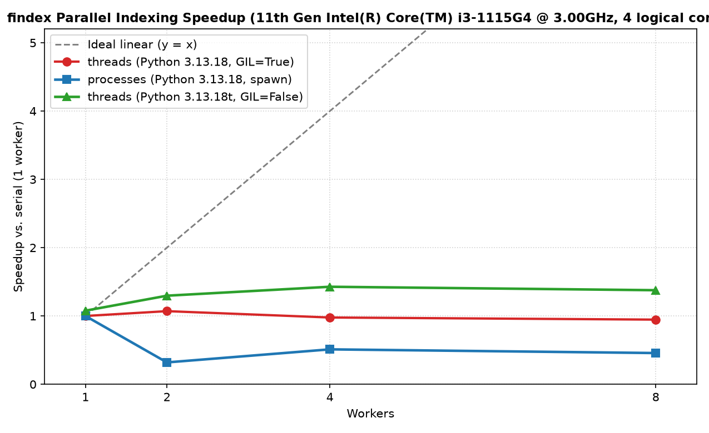

# findex — Streaming Full-Text Search Engine

[](https://github.com/Spice1411/findex/actions/workflows/ci.yml)

A full-text search engine built incrementally in Python: streaming corpus intake, polite async web crawler (`asyncio` + `httpx`), parallel inverted index construction, Boolean & phrase queries, TF-IDF/BM25 ranking, strict typing, property-based tests, and a packaged Typer + Rich CLI.

---

## Lab 06 — The Async Crawler: `asyncio`, Coroutines, and Structured Concurrency

### What was added

- **Polite fetcher (`src/findex/crawler/fetch.py`):** `async def fetch()` with `asyncio.timeout`, honest `User-Agent` with contact URL, status/bytes/elapsed tracking, and bounded retries (max 3) with exponential backoff + jitter on `429`, `5xx`, and timeouts while honoring `Retry-After` and never retrying non-429 `4xx` or redirect loops.
- **`robots.txt` cache (`src/findex/crawler/robots.py`):** `RobotsCache` fetches `/robots.txt` asynchronously once per host and enforces `Disallow` and `Crawl-delay`.
- **Frontier & structured concurrency (`src/findex/crawler/crawl.py`, `parse.py`):** `async def crawl()` async generator backed by `asyncio.Queue`, `asyncio.TaskGroup` workers, global + per-host `asyncio.Semaphore`, per-host minimum delay, URL canonicalization + `seen` set, and stdlib `html.parser` link/text extraction with clean shutdown at `max_pages`.
- **CLI integration (`findex crawl`):** streams crawled pages to JSONL (`data/crawl.jsonl`) consumed directly by `iter_documents()` and `findex index` outside the event loop, with a live `rich` dashboard and per-URL `crawl.log`.

```bash
# Run the local ethical mirror in terminal 1 (or crawl any robots.txt-permitted docs site)
uv run python scripts/local_mirror.py --ports 4 --base-port 8765

# Crawl politely with live Rich counters and streaming JSONL output
findex crawl http://127.0.0.1:8765/ --max-pages 200 --concurrency 10 --per-host 2 --out data/crawl.jsonl

# Index crawled pages outside the event loop and search them
findex index data/crawl.jsonl --out crawl.bin --positions --executor serial
findex search crawl.bin 'asyncio AND "event loop"' --k 5
```

<!-- LAB06-RESULTS-START -->
### Ethics & permission

- **Target crawled:** our own local multi-origin ethical HTML documentation mirror (`scripts/local_mirror.py` running on `127.0.0.1` across 4 local ports with 20 ms simulated network latency, `/robots.txt`, and controlled 429/timeout/redirect-loop endpoints). Permission is implicit because we own and operate the mirror locally.
- **Politeness safeguards:** honest `User-Agent: findex-crawler/0.6 (+https://github.com/Spice1411/findex)`, `RobotsCache` obeying `/robots.txt` (`Disallow: /private/`), global + per-host `asyncio.Semaphore`, per-host minimum delay, domain allowlist, and hard `--max-pages` ceiling.

### Async crawler benchmark (`max_pages = 220`, same seed URL)

| Concurrency | Pages | Wall (s) | Pages/s | Errors | Peak RSS |
|---:|---:|---:|---:|---:|---:|
| 1 (effectively sequential) | 220 | 9.586 | 23.0 | 3 | 40.0 MB |
| 5 | 220 | 2.607 | 84.4 | 3 | 42.0 MB |
| 20 | 220 | 1.372 | 160.3 | 2 | 44.9 MB |

- **Event-loop debug verification (`debug=True`):** `0` slow-callback warnings (>100 ms).
- **Post-crawl offline indexing (`findex index data/crawl.jsonl`):** indexed `220` streamed documents (`265` terms) in `0.043 s` outside the event loop.

### Handled failures & politeness excerpt (`crawl.log`)

```text
2026-11-22T23:28:56+00:00	ROBOTS	0B	0.0ms	attempts=0	http://127.0.0.1:49825/private/secret	disallowed
2026-11-22T23:28:57+00:00	404	9B	67.0ms	attempts=1	http://127.0.0.1:49825/missing-404	HTTP 404
2026-11-22T23:28:57+00:00	200	129B	314.9ms	attempts=2	http://127.0.0.1:49825/rate-limited	OK
2026-11-22T23:28:57+00:00	ERR	0B	445.0ms	attempts=1	http://127.0.0.1:49825/redirect-loop	redirect loop: Exceeded maximum allowed redirects.
```

Notice that `/rate-limited` returned HTTP `429` with `Retry-After: 0.15` on attempt 1 and succeeded (`200`, `attempts=2`) after waiting; `/slow-timeout` tripped `asyncio.timeout` and exited cleanly after bounded retries; `/redirect-loop` stopped immediately without retrying; `/private/secret` was blocked by `RobotsCache` before any request was sent.

### Asyncio vs. Lab 5, per-host politeness cost, and blocking analysis

**1. Why 20 concurrent coroutines in one thread beat Lab 5 for crawling.** Raising concurrency from 1 to 20 lifted throughput from **23.0** to **160.3 pages/s** (**7.0×** speedup) inside a single OS thread with low memory (**44.9 MB** Peak RSS). Unlike Lab 5's CPU-bound indexing, crawling spends almost all wall time waiting on sockets (`await client.get(...)`). One event loop multiplexes all 20 in-flight sockets via OS readiness events and reuses one `httpx.AsyncClient` pool — without spawning 20 processes or pickle IPC.

**2. What per-host limits cost — and why we keep them.** Tightening the per-host limit to `per_host=1` and `min_delay=50 ms` at the same `concurrency=20` slowed the 220-page crawl from **1.372 s** (160.3 pages/s) to **4.562 s** (48.2 pages/s). That throttling is intentional: without per-host semaphores and minimum delays, an async crawler turns into a self-inflicted DoS against a single origin, triggering `429` bans and dropping connections.

**3. Where the event loop would stall if indexing ran inline.** Tokenizing, Unicode normalization, and inverted-index dict updates are pure CPU loops with zero `await` points. Running `build_index` directly inside a worker coroutine would freeze the single event loop for tens or hundreds of milliseconds per page — delaying heartbeats, socket reads, and `asyncio.timeout` deadlines for all other 19 in-flight requests (and triggering `debug=True` slow-callback warnings). Streaming raw pages to `data/crawl.jsonl` and running `findex index` afterward keeps I/O inside `asyncio` and CPU work outside the loop.
<!-- LAB06-RESULTS-END -->

---

## Lab 05 — Concurrency and the GIL: Threads, Processes, and Parallel Indexing

- **CPU:** 11th Gen Intel(R) Core(TM) i3-1115G4 @ 3.00GHz (4 logical cores), Windows, 20 Newsgroups (18,846 docs).
- **Standard Python:** `3.13.18` (`sys._is_gil_enabled() == True`) · **Free-threaded Python:** `3.13.18t` (`sys._is_gil_enabled() == False`).

| Executor | Workers | Wall (s, median) | CPU (s) | Peak RSS | Merge (s) | Speedup |
|---|---:|---:|---:|---:|---:|---:|
| `processes` | 4 | 25.520 | 34.016 | 527.2 MB | 0.337 | 0.51× |
| `processes` | 8 | 28.535 | 37.109 | 527.2 MB | 0.514 | 0.46× |
| `serial (3.13t, GIL=False)` | 1 | 12.111 | 11.797 | 323.7 MB | 0.173 | 1.08× |
| `threads (3.13t, GIL=False)` | 2 | 10.063 | 16.594 | 339.4 MB | 0.771 | 1.30× |
| `threads (3.13t, GIL=False)` | 4 | 9.141 | 23.656 | 339.4 MB | 0.754 | 1.43× |
| `threads (3.13t, GIL=False)` | 8 | 9.476 | 25.219 | 339.4 MB | 0.714 | 1.38× |



- **I/O-bound counter-benchmark (32 local HTTP requests):** 1 thread `0.942 s (1.00×)` → 2 threads `0.424 s (2.22×)` → 4 threads `0.219 s (4.30×)` → 8 threads `0.116 s (8.11×)`.
- **Free-threaded `3.13t` race experiment (4 threads × 400,000):** unsafe `shared += 1` produced `868,293` (lost `731,707` updates); both `threading.Lock` and thread-local `build_partial` + `merge` produced the exact `1,600,000`.

---

## Installation & CLI (Lab 04)

```bash
uv tool install .
uv tool install https://github.com/Spice1411/findex/releases/download/v0.4.0/findex-0.4.0-py3-none-any.whl
```

- **Static typing:** `uv run pyright` (`typeCheckingMode = "strict"`, 0 errors).
- **Linting & formatting:** `uv run ruff check .` and `uv run ruff format --check .`.

<!-- LAB04-COVERAGE-START -->
- **Total coverage (`src/findex`):** **77.9%** (1734/2226 statements).

| Module | Statements | Missed | Coverage |
|---|---:|---:|---:|
| `src/findex/__init__.py` | 9 | 0 | 100.0% |
| `src/findex/cli.py` | 188 | 56 | 70.2% |
| `src/findex/corpus.py` | 79 | 14 | 82.3% |
| `src/findex/crawler/__init__.py` | 5 | 0 | 100.0% |
| `src/findex/crawler/crawl.py` | 215 | 37 | 82.8% |
| `src/findex/crawler/fetch.py` | 118 | 22 | 81.4% |
| `src/findex/crawler/parse.py` | 87 | 7 | 92.0% |
| `src/findex/crawler/robots.py` | 70 | 18 | 74.3% |
| `src/findex/decorators.py` | 15 | 0 | 100.0% |
| `src/findex/eval.py` | 122 | 122 | 0.0% |
| `src/findex/index.py` | 418 | 118 | 71.8% |
| `src/findex/models.py` | 157 | 5 | 96.8% |
| `src/findex/query.py` | 220 | 14 | 93.6% |
| `src/findex/ranking.py` | 40 | 4 | 90.0% |
| `src/findex/search.py` | 192 | 31 | 83.9% |
| `src/findex/snippets.py` | 99 | 20 | 79.8% |
| `src/findex/stats.py` | 96 | 21 | 78.1% |
| `src/findex/store.py` | 84 | 3 | 96.4% |
| `src/findex/tokenize.py` | 12 | 0 | 100.0% |

**Intentionally left outside coverage:**
- Legacy `if __name__ == '__main__':` entry points in `index.py`, `search.py`, `stats.py`, `eval.py` — superseded by the packaged `findex` CLI (`cli.py`).
- Lab 2 memory-study benchmark runner (`run_memory_study`) and network download fallbacks in `scripts/download_corpus.py` — slow / external-network paths.
- Defensive `OSError` handlers for corrupt files or unreadable disks.
<!-- LAB04-COVERAGE-END -->

---

## Lab 01–03 Highlights

- **Lab 01 (Eager vs. Lazy on 20 Newsgroups, 18,846 docs, 5,812,698 tokens):** eager `333.12 MB` (`28.557 s`) vs lazy generators `19.15 MB` (`42.375 s`) — **17.4×** less peak RAM.
- **Lab 02 (Memory study):** plain `@dataclass` `309.38 MB` → `slots=True` `234.30 MB` (`51.06 MB` file) → `array('I')` pairs `35.10 MB` file (`5.434 s` load vs `58.542 s`).
- **Lab 03 (Ranking & Evaluation):** `Index(Mapping)`, `open_index`, `Scorer` protocol (`TfIdf` vs `BM25`), recursive-descent query parser, `@timed` + `lru_cache` (`4.32 ms` MISS → `2.69 ms` HIT), snippets, and 10-query **Precision@5** (`0.96` TF-IDF vs `0.92` BM25).
