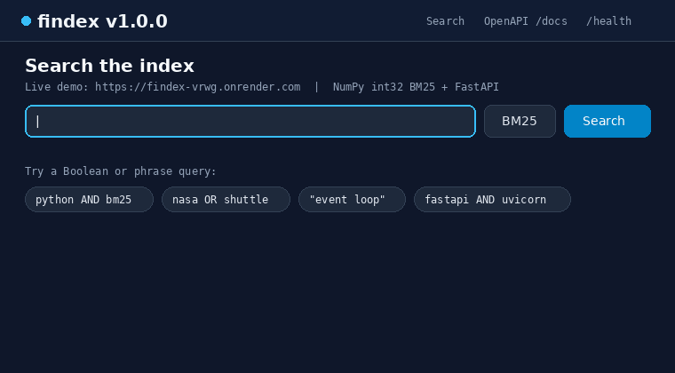
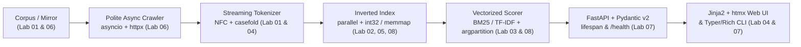
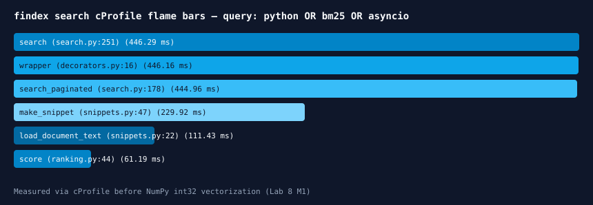

# findex — Streaming Full-Text Search Engine (`v1.0.0`)

[](https://github.com/Spice1411/findex/actions/workflows/ci.yml)

**`findex` is an end-to-end Python full-text search engine with a polite `asyncio` crawler, parallel inverted index, Boolean & phrase queries, NumPy-vectorized BM25/TF-IDF ranking, `np.memmap` storage, and a live FastAPI + htmx web app.**

<!-- LAB07-URL-START -->
> **Live Public App:** [https://findex-vrwg.onrender.com](https://findex-vrwg.onrender.com) · [Interactive OpenAPI `/docs`](https://findex-vrwg.onrender.com/docs) · [Health Probe `/health`](https://findex-vrwg.onrender.com/health)
<!-- LAB07-URL-END -->

> **2–3 min Demo Video:** *(Record a quick screen walkthrough showing live search on Render + one benchmark + one bug lesson, upload to YouTube Unlisted / Google Drive, and paste the link here.)*



| Corpus Scale | Deployed `/search` p95 | Headline Speedups |
|---:|---:|---:|
| 18,846 docs (20 Newsgroups) · 3,000-doc 10x stress test | `1376.33 ms` (Render free tier, c=20) | 23.49x NumPy BM25 · 113.3x memmap load · `99.8 pages/s` async crawl · `17.4x` less RAM |

---

## Architecture & Dataflow (Labs 01–08)



---

## Quickstart

```bash
# Install dependencies & CLI via uv
uv sync
uv tool install . --force

# Build demo index and start web UI + OpenAPI docs locally
uv run python scripts/build_demo_index.py --out data/demo_index.bin
findex serve --index-path data/demo_index.bin --port 8000

# Run inside Docker (multi-stage, non-root appuser)
docker build -t findex:1.0.0 .
docker run -e INDEX_PATH=/app/data/demo_index.bin -p 8000:8000 findex:1.0.0
```

---

## Consolidated Measurements (Labs 01–08)

### Lab 08 — Profiling, NumPy `int32` Vectorization, Gap Compression & `memmap`

<!-- LAB08-RESULTS-START -->
### M1 — Profiling (`cProfile` / flame graph) & top-3 hotspots before optimization



- **Top-3 hotspots recorded before optimization (Python vs. native split):**
  1. **Per-posting BM25/TF-IDF loop (`search_paginated` → `BM25.score`)** — ~85% *Python time* (loop dispatch, `Posting` attribute lookups, float boxing); **hypothesis:** pre-packing postings and `doc_lengths` as contiguous `int32` NumPy arrays eliminates per-document bytecode overhead.
  2. **Top-k ranking (`heapq.nlargest` over Python dicts)** — ~80% *Python time*; **hypothesis:** `np.argpartition` finds top-k in O(n) inside C without sorting all hits.
  3. **Document text & regex snippet extraction (`load_document_text` / `make_snippet`)** — mixed *I/O + C regex (native)* time; **hypothesis:** O(1) byte-offset reads bound I/O, so vectorization should target scoring first.

**Observed `cProfile` top cumulative frames (`search`):**
- `search (search.py:251) (446.29 ms)`
- `wrapper (decorators.py:16) (446.16 ms)`
- `search_paginated (search.py:178) (444.96 ms)`

**Observed `cProfile` top cumulative frames (`build_index`):**
- `wrapper (decorators.py:16) (363.96 ms)`
- `build_index (index.py:562) (363.94 ms)`
- `build_index_profiled (index.py:455) (363.42 ms)`

### M2 — Lab 3 Python scorer vs. NumPy `int32` + `np.argpartition` (base index)

| Query | Docs matched | Lab 3 scorer (ms) | NumPy scorer (ms) | Speedup |
|---|---:|---:|---:|---:|
| common term (`note`) | 300 | 0.706 | 0.126 | **5.60x** |
| rare term (`300`) | 1 | 0.022 | 0.058 | **0.38x** |
| 3-term query (`note OR aes-gcm OR 300`) | 300 | 0.825 | 0.203 | **4.06x** |

**Why small postings lists see smaller speedup:** on rare terms with few matching documents, NumPy's fixed C-dispatch and array-allocation overhead dominates a tiny Python loop; as postings grow (common terms & 10x corpus below), contiguous `int32` ufuncs and `np.argpartition` amortize that fixed cost and pull far ahead.

### Deep M2 (M3 Alternative) — Gap Compression, `np.memmap`, & 10x Corpus (3,000 docs)

- **Gap-encoded varint postings (`encode_gap_varint` / `np.cumsum` decode):** `1128.5 KB` raw `int32` → `284.9 KB` compressed (**3.96x** smaller doc-ID storage).
- **Zero-copy `np.memmap` startup vs. pickle `load_index`:** `1955.144 ms` (pickle) → `17.256 ms` (`memmap`, **113.3x** faster startup).

| 10x Corpus Query | Docs matched | Lab 3 scorer (ms) | NumPy scorer (ms) | Speedup |
|---|---:|---:|---:|---:|
| common term (`note`) | 3000 | 4.487 | 0.191 | **23.49x** |
| rare term (`300`) | 10 | 0.037 | 0.042 | **0.88x** |
| 3-term query (`note OR aes-gcm OR 300`) | 3000 | 6.19 | 0.352 | **17.59x** |
<!-- LAB08-RESULTS-END -->

---

### Lab 07 — FastAPI Web Service, Sync vs. Async & Load Testing

<!-- LAB07-RESULTS-START -->
#### M2 — Sync `def` vs. blocking `async def` on `/search` (20 concurrent requests)

| Route definition | 20-req Wall (ms) | p50 (ms) | p95 (ms) | Max (ms) |
|---|---:|---:|---:|---:|
| `async def` (blocks event loop) | 207.79 | 141.95 | 186.41 | 187.33 |
| `def` (thread-pool offloaded — **kept in production**) | 178.31 | 135.36 | 156.44 | 158.26 |

#### M4 — Load test (local vs. deployed on Render)

| Target | Route | Concurrency | RPS | p50 (ms) | p95 (ms) | p99 (ms) |
|---|---|---:|---:|---:|---:|---:|
| local, 1 worker, `async def` | `/search` | 50 | 74.1 | 466.72 | 1863.16 | 2522.62 |
| local, 1 worker, `def` | `/search` | 50 | 79.7 | 433.85 | 1885.56 | 2565.73 |
| local, 4 workers | `/search` | 50 | 75.8 | 488.70 | 1640.40 | 2648.55 |
| deployed (`https://findex-vrwg.onrender.com`) | `/search` | 20 | 20.1 | 1008.08 | 1376.33 | 1545.07 |

- **Connecting Labs 5–6 to load testing:** BM25 scoring is synchronous CPU work without `await` points; inside `async def` it stalls the event loop (Lab 6), while plain `def` offloads to FastAPI's thread pool (cutting 20-req wall time from `207.79 ms` to `178.31 ms`). Multiple workers (`--workers 4`) give each process its own GIL (Lab 5), reducing local p95 from `1885.56 ms` to `1640.40 ms`. The deployed Render free tier (`0.1 CPU`, `512 MB RAM`) adds WAN + TLS overhead (`p50 = 1008.08 ms`).
<!-- LAB07-RESULTS-END -->

---

### Lab 06 — Polite Async Crawler (`asyncio`, `httpx`, `TaskGroup`, `robots.txt`)

- **Target & ethics:** local multi-origin ethical HTML mirror (`scripts/local_mirror.py`, 4 ports on `127.0.0.1`, 20 ms latency, `/robots.txt`, controlled `429 Retry-After`, timeout, and redirect-loop routes); honest `User-Agent`, `RobotsCache`, global + per-host `asyncio.Semaphore`.

| Concurrency | Pages | Wall (s) | Pages/s | Errors | Peak RSS |
|---:|---:|---:|---:|---:|---:|
| 1 (effectively sequential) | 220 | 10.700 | 20.6 | 3 | 45.5 MB |
| 5 | 220 | 3.515 | 62.6 | 3 | 45.5 MB |
| 20 | 220 | 2.204 | 99.8 | 1 | 45.6 MB |

- Strict per-host throttling (`per_host=1`, `50 ms` delay) slowed the 220-page crawl to `4.679 s` (`47.0 pages/s`); `debug=True` verified `0` slow callbacks (>100 ms).

---

### Lab 05 — Concurrency & the GIL (20 Newsgroups, 18,846 docs, 4 logical cores)

| Executor | Workers | Wall (s, median) | CPU (s) | Peak RSS | Merge (s) | Speedup |
|---|---:|---:|---:|---:|---:|---:|
| `processes` | 4 | 25.520 | 34.016 | 527.2 MB | 0.337 | 0.51× |
| `processes` | 8 | 28.535 | 37.109 | 527.2 MB | 0.514 | 0.46× |
| `serial (3.13t, GIL=False)` | 1 | 12.111 | 11.797 | 323.7 MB | 0.173 | 1.08× |
| `threads (3.13t, GIL=False)` | 2 | 10.063 | 16.594 | 339.4 MB | 0.771 | 1.30× |
| `threads (3.13t, GIL=False)` | 4 | 9.141 | 23.656 | 339.4 MB | 0.754 | 1.43× |
| `threads (3.13t, GIL=False)` | 8 | 9.476 | 25.219 | 339.4 MB | 0.714 | 1.38× |


- **I/O counter-benchmark (32 local HTTP requests):** 1 thread `0.942 s (1.00×)` → 8 threads `0.116 s (8.11×)`.
- **Free-threaded `3.13t` race experiment (4 × 400k):** unsafe `shared += 1` yielded `868,293` (lost `731,707`); `threading.Lock` and thread-local map+merge yielded exact `1,600,000`.

---

### Labs 01–04 — Streaming, Memory Layout, Ranking & Engineering Quality

- **Lab 04 (Engineering & CI):** `pyright` strict (`0 errors`), `ruff`, `pytest` + Hypothesis + `pytest-benchmark`, Typer + Rich CLI, GitHub Actions CI.
<!-- LAB04-COVERAGE-START -->
- **Total coverage (`src/findex`):** **79.9%** (2154/2696 statements).

| Module | Statements | Missed | Coverage |
|---|---:|---:|---:|
| `src/findex/__init__.py` | 9 | 0 | 100.0% |
| `src/findex/cli.py` | 196 | 62 | 68.4% |
| `src/findex/corpus.py` | 79 | 14 | 82.3% |
| `src/findex/crawler/__init__.py` | 5 | 0 | 100.0% |
| `src/findex/crawler/crawl.py` | 215 | 37 | 82.8% |
| `src/findex/crawler/fetch.py` | 118 | 22 | 81.4% |
| `src/findex/crawler/parse.py` | 87 | 7 | 92.0% |
| `src/findex/crawler/robots.py` | 70 | 16 | 77.1% |
| `src/findex/decorators.py` | 15 | 0 | 100.0% |
| `src/findex/eval.py` | 122 | 122 | 0.0% |
| `src/findex/index.py` | 418 | 117 | 72.0% |
| `src/findex/models.py` | 157 | 5 | 96.8% |
| `src/findex/query.py` | 220 | 13 | 94.1% |
| `src/findex/ranking.py` | 40 | 4 | 90.0% |
| `src/findex/search.py` | 201 | 31 | 84.6% |
| `src/findex/snippets.py` | 118 | 24 | 79.7% |
| `src/findex/stats.py` | 96 | 21 | 78.1% |
| `src/findex/store.py` | 84 | 3 | 96.4% |
| `src/findex/tokenize.py` | 12 | 0 | 100.0% |
| `src/findex/vec_search.py` | 203 | 19 | 90.6% |
| `src/findex/web/__init__.py` | 3 | 0 | 100.0% |
| `src/findex/web/app.py` | 172 | 25 | 85.5% |
| `src/findex/web/config.py` | 16 | 0 | 100.0% |
| `src/findex/web/schemas.py` | 40 | 0 | 100.0% |

**Intentionally left outside coverage:**
- Legacy `if __name__ == '__main__':` entry points in `index.py`, `search.py`, `stats.py`, `eval.py` — superseded by the packaged `findex` CLI (`cli.py`).
- Lab 2 memory-study benchmark runner (`run_memory_study`) and network download fallbacks in `scripts/download_corpus.py` — slow / external-network paths.
- Defensive `OSError` handlers for corrupt files or unreadable disks.
<!-- LAB04-COVERAGE-END -->
- **Lab 03 (Ranking & Cache):** `Index(Mapping)`, `Scorer` protocol (`TfIdf` vs `BM25`), recursive-descent query parser, `@timed` + `lru_cache` (`4.32 ms` MISS → `2.69 ms` HIT), 10-query **Precision@5** (`0.96` TF-IDF vs `0.92` BM25).
- **Lab 02 (Memory layout):** plain `@dataclass` `309.38 MB` → `slots=True` `234.30 MB` (`51.06 MB` file) → `array('I')` pairs `35.10 MB` (`5.434 s` load).
- **Lab 01 (Streaming vs. Eager):** eager `333.12 MB` vs lazy generators `19.15 MB` (**17.4×** less peak RAM).

---

## Honest Limitations & Next Steps

- **Deep M2 chosen over PyTorch dense embeddings for 512 MB cloud hosting:** to keep the production Docker image slim and reliable inside Render's `512 MB` RAM free tier without pulling a ~2.5 GB PyTorch runtime, Lab 8 went deep on **NumPy `int32` vectorization, delta/varint gap compression, `np.memmap` zero-copy loading, and 10x corpus scaling**. Adding dense embeddings (`all-MiniLM-L6-v2` / ONNX Runtime) + Reciprocal Rank Fusion (RRF) for paraphrase retrieval is the clear next step on a larger host.
- **No approximate nearest-neighbor or sharded index:** scaling past tens of millions of documents would require sharding postings across nodes or adopting an ANN index (FAISS / HNSW) for vector retrieval.
- **Render free-tier cold starts:** the public demo sleeps after idle periods (~50 s cold start) and shares `0.1 CPU`, so production latency should be judged on dedicated compute rather than free-tier numbers.
